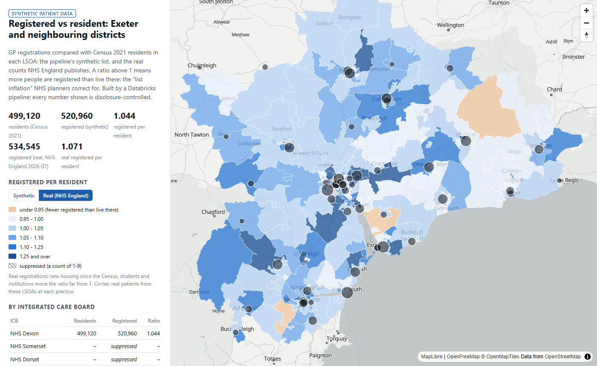
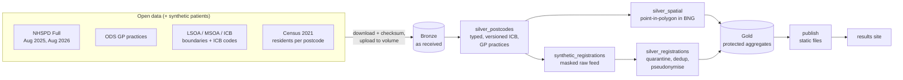

# GB Demographic & Geospatial Pipelines on Databricks

Databricks pipelines that join demographic records to GB geographic reference data (NHS and ONS
postcode products, ODS, LSOA / MSOA / ICB boundaries, Census 2021) and deliver reconciled, versioned,
pseudonymised and disclosure-controlled datasets for population analysis and service planning.

All patient-level records are **synthetic** (NHS numbers from the reserved 999 test range).
Everything else is real open data.

[](https://github.com/petersolan/GB-Demographic-Geospatial-Databricks/actions/workflows/ci.yml)

**[Live results site](https://petersolan.github.io/GB-Demographic-Geospatial-Databricks/)**: the published, disclosure-controlled outputs on a map.



*The results site (`site/`), real view: GP registrations per Census 2021 resident for Exeter, East Devon,
Mid Devon and Teignbridge, from NHS England's published counts; a switch shows the synthetic list on the
same scale. Every number is disclosure-controlled.*

## What it demonstrates

| Capability | How |
|---|---|
| Databricks, PySpark, SQL, Delta Lake | 7-task medallion pipeline deployed as a Databricks Asset Bundle on serverless compute; Unity Catalog schemas per layer |
| Postcode standardisation + enrichment | Deterministic cleaning, format checks, joins to the NHS Postcode Directory (incl. terminated postcodes) and ODS practices; quarantine with reason codes |
| Spatial joins, point-in-polygon, edge cases | Native Databricks spatial SQL (`GEOMETRY`, `ST_Covers`) in British National Grid; bounding-box filter then refine; on-boundary, no-match and multi-match rules |
| CRS + geometry validation | BNG (EPSG:27700) throughout, WGS84 only for the web; `ST_IsValid`, Shapely repair UDF (no `ST_MakeValid` in Databricks); WKT / WKB / GeoJSON / GeoParquet |
| Versioned lookups and boundaries | ICB code and boundary editions as SCD2 (`valid_from` / `valid_to`); each NHSPD release joined to the edition in force; gold reads every input pinned to a Delta version and records input and output versions, so any run can be rebuilt with time travel (tested) |
| Data quality + reconciliation | Flags per row, quarantine tables, rows-in = rows-out assertions after every join, metrics table per run, results measured against a ground truth |
| Spark optimisation | Spatial join benchmark from 10k to 2.4M points with query-plan capture and a query-profile breakdown; liquid clustering on the large silver tables, measured at 109M rows; broadcast joins for lookups; idempotent per-version writes; repair runs |
| Access, pseudonymisation, disclosure control | Unity Catalog grants in the bundle (analysts read gold only); column mask on raw NHS numbers; HMAC-SHA256 `patient_id` with the key in a secret scope; year of birth + age band only (data minimisation); counts 1-9 suppressed and others rounded to 5 |
| Git, CI/CD, automated tests | GitHub Actions: ruff + 81 unit tests on open-source PySpark, then `bundle validate` on pull requests and `bundle deploy -t prod` from main; integration tests (spatial edge cases, reproducibility, catalog docs) run pytest inside a Databricks job |
| Communication with analysts | Gold tables and columns described once in code, written to Unity Catalog comments and to a [data dictionary](docs/data_dictionary.md); a test keeps them in sync; findings below in plain language |
| Census geographies | Outputs by LSOA, MSOA, ICB and GP practice |
| NHS demographic data | The synthetic list calibrated against NHS England's *Patients Registered at a GP Practice* (patients by practice and LSOA 2021); the comparison found and fixed a generator bug |

## Architecture



Bronze, silver and gold are separate Unity Catalog schemas, and the bundle grants access per layer
(`resources/schemas.yml`): analysts get `USE SCHEMA` + `SELECT` on gold and `READ VOLUME` on its
exports, and no grants at all on bronze or silver. Gold holds only disclosure-controlled values
and is the only source of anything that leaves the platform. Its tables are documented in the
[data dictionary](docs/data_dictionary.md), the same text analysts see as column comments in
Catalog Explorer.

## Findings

- **Real registrations vary far more than any uniform assumption.** Against NHS England's published
  counts, real list inflation over the study area is 1.071 (synthetic 1.044), and per LSOA it runs from
  0.97 to 1.31 (5th to 95th percentile) where the synthetic list stays within 1.04-1.05. The extremes
  are explainable: new housing built since the Census, and institutions whose residents are not on NHS
  GP lists (see [Calibration](#calibration-against-real-nhs-registrations)).
- **Calibration caught a bug the tests could not.** The synthetic generator chose among every active
  ODS organisation, so minor injury units, HMP Exeter and pharmacies received 26% of registrations.
  No unit test expected that; comparing with real practice lists made it obvious. The generator now
  uses GP practices (ODS role RO76) only.
- **The spatial check found errors in NHSPD a release before ONS fixed them.** For Devon postcodes,
  point-in-polygon and NHSPD's own LSOA assignment agree for 99.99%. All 7 disagreements in the August
  2025 release were changed by ONS in August 2026 to exactly the LSOA the spatial join had found.
- **ICB codes must follow the edition in force.** NHSPD's ICB codes match the April 2023 code list for
  the 2025 release (99.95%) and the April 2026 list for the 2026 release (99.94%); pairing the wrong
  editions loses over a quarter of English postcodes. Merged ICBs got new 5-character ODS codes, and
  NHS Hampshire and Isle of Wight kept its name with a new code (join on codes, never names).
- **Rule-based validation has a blind spot.** Blank, malformed and bad-check-digit records were all
  caught (100% against the injected defects), but 1,173 of 1,291 postcode typos produced real postcodes
  elsewhere and cannot be detected by format or NHSPD-membership checks. Plausibility rules flag 145 of
  them (12%) for review, with 4 false alarms in 507,877 correct records (see below). The real fix is
  address-level (UPRN) matching.
- **Points in water.** 23 Devon postcodes fall in no LSOA: estimated positions of terminated postcodes in
  the Exe and Taw estuaries, Plymouth Sound and the Tamar. The coast-clipped (BFC) boundaries exclude
  tidal water; these rows are kept, counted and fall back to NHSPD's assignment.
- **Real data is messier than rules.** NHSPD contains the historic Newport `NPT` postcode area and
  Girobank's `GIR 0AA`, both outside the usual postcode pattern, and 850 non-geographic postcodes with
  no location.

## Calibration against real NHS registrations

NHS England publishes *Patients Registered at a GP Practice* every quarter at LSOA 2021 level: patients
per practice per LSOA of residence, from the GP Payments system (63.4 million patients in July 2026,
103,890 of them with no usable LSOA). `gbdemo.calibration` compares it with the synthetic list and
Census 2021 residents over the 296 study LSOAs; results are in `gold.lsoa_calibration` and
`gold.practice_calibration`, protected like every gold table.

| Study area (4 districts) | Synthetic | Real, NHS England July 2026 |
|---|---|---|
| Registered patients | 520,938 | 534,546 |
| Registered per Census resident (499,118) | 1.044 | 1.071 |
| Per LSOA, 5th to 95th percentile | 1.036 to 1.053 | 0.966 to 1.306 |
| LSOAs with fewer registered than residents | 0 | 23% |
| Exeter | 1.044 | 1.106 |

What moves the real ratio, from the LSOAs at either end:

- **New housing.** The 15 LSOAs with 10 or more postcodes introduced after Census day have a median
  real ratio of 1.34, against 1.03 elsewhere; the highest (up to 2.23) are the new developments east of
  Exeter. These people exist now but were not there to be counted in March 2021. Population growth and
  list inflation can only be separated with newer population estimates.
- **Institutions.** Low ratios match residents who are not on NHS GP lists: an LSOA covering Lympstone,
  home of the Royal Marines' training centre (0.62; service personnel are registered with Defence
  Medical Services), and one that likely covers HMP Channings Wood (0.72; prisoners get prison health
  care). Student areas around the university appear at both ends: Census 2021 was taken during
  lockdown, when many students were not at their term-time address.

The practice side tests the generator's choice model (each person picks one of the three nearest
practices, weighted by distance):

- Before the fix, 26% of synthetic registrations went to organisations that hold no list. After it,
  88.8% of real study-area patients are registered in a (home LSOA, practice) pair the model also
  uses, up from 82.3%.
- Practice list sizes correlate at 0.65 (59 practices with 500 or more patients on either side).
  Distance alone underestimates large central practices (St Thomas Medical Group: 14,255 synthetic,
  37,785 real) and overestimates special-purpose ones (Inclusion Health Devon, a service for people who
  are homeless: 12,780 synthetic, 615 real). Weighting the choice by real list size would be the next
  step.

## Performance

Point-in-polygon of located postcodes against all 35,672 LSOAs in England and Wales, on Databricks Free
Edition serverless (`resources/benchmark_job.yml`). Two query forms: `ST_Covers` alone, and a manual
bounding-box pre-filter followed by `ST_Covers`.

| Points | `ST_Covers` only | bbox + `ST_Covers` | Join operator in the physical plan |
|---|---|---|---|
| 10,000 (South West sample) | 5.2 s | 5.7 s | `PhotonShuffledSpatialJoin` |
| 254,416 (South West region) | 6.0 s | 5.8 s | `PhotonShuffledSpatialJoin` |
| 2,413,799 (England and Wales) | 8.4 s | 8.1 s | `PhotonShuffledSpatialJoin` |

240 times more points cost about 1.6 times the time, and the manual pre-filter changes nothing: the
plan shows Databricks' native spatial join (Photon) partitions space and filters internally for both
forms. The hand-written optimisation was measured, found redundant on this engine, and would only
pay off on an engine without a spatial join operator.

### Reading the query profile

To see where the time goes, the national `ST_Covers` join was run once on the SQL warehouse
(Serverless Starter, 2X-Small, cold) and its query profile read in the UI. Wall time was 30 s: 4 s
waking the warehouse, 10.7 s compilation and 15.5 s execution spread over 24 tasks. The profile
reports task time summed over parallel tasks:

| Operator | Task time | Rows | What it does |
|---|---|---|---|
| Inner join (`ST_Covers`) | 17.8 s | 2.41 M out | exact point-in-polygon test inside each bin |
| Sampling scan, `lsoa21_geo` | 16.4 s | 35.67 K → 3.45 K | measures geometry extents to choose the bin size |
| Shuffle on `binId`, polygon side | 6.0 s | 50.34 K | moves polygon copies, each with its full boundary |
| Sampling scan, `postcode` | 5.3 s | 2.41 M → 241.88 K | the same for points |
| Main scan, `lsoa21_geo` | 1.1 s | 35.67 K | |
| Bin generator | 0.13 s | 35.67 K → 50.34 K | assigns each geometry to its x-axis bins |

These add up to the query's 47.6 s of Photon time. Three things stand out:

- **Binning copies polygons.** 41% more polygon rows leave the bin generator than enter it: a
  polygon that crosses a bin edge goes to every bin it touches. Points never cross, so they stay at
  2.41 M, and the join removes the duplicate matches this could create (2,413,459, the same count
  as the benchmark).
- **The exact test is the largest single cost**, not reading or binning. That is why the manual
  bounding-box filter gained nothing: bins already discard distant polygons, and what remains is
  testing points against detailed LSOA boundaries (31.9 M vertices in total). The usual next step
  would be to split large polygons into smaller pieces, which tightens bins and makes each test
  cheaper.
- **Choosing the bin size is not free.** Sampling both inputs took almost as long as the join. The
  polygon sample scan (16.4 s) cost far more than the main polygon scan (1.1 s), most likely because
  it was the first read of the geometry column on a cold warehouse (half the bytes came from cloud
  storage, half from cache).

### Table layout: liquid clustering

`silver.postcode` is clustered by `(nhspd_release, lad_code)` and `silver.registrations` by
`(lad_code, lsoa21_code)`, the keys most reads filter on (`gbdemo/clustering.py`). At today's size
this skips nothing: the tables are one or two files per release, and the release filter already
reads only one of them. Clustering matters once a table spans many files, so it was measured at
that scale (`pipelines/benchmark_layout.py`): 40 monthly snapshots of every postcode, 109 million
rows, about 700 MB, written once in arrival order and once clustered by `(snapshot, lad_code)`,
both compacted to the same 16 MB target file size. The same queries ran on the SQL warehouse and
files read / skipped come from its query history (`scripts/measure_layout.py`):

| Query | Layout | Files read | Files skipped | MB read | Time |
|---|---|---|---|---|---|
| One area (Exeter), all snapshots | arrival order | 43 | 0 | 228 | 3.0 s |
| | clustered | 9 | 47 | 42 | 1.5 s |
| One area, one snapshot | arrival order | 1 | 42 | 6 | 0.6 s |
| | clustered | 1 | 55 | 7 | 0.7 s |
| One snapshot, all areas | arrival order | 1 | 42 | 6 | 0.6 s |
| | clustered | 6 | 50 | 28 | 1.0 s |

Clustering cut the data read for an area's history by 5.4 times. It costs nothing for a single
snapshot of one area, and it loses for a whole snapshot, which arrival order already keeps in one
file: clustering on two keys spreads each snapshot over a few files. Keys are a trade-off chosen
from the queries that matter most, and unlike Hive partitions they can be changed later.

## Plausibility checks

Typos that land on other real postcodes pass every format and lookup check. Candidate rules were
measured against the synthetic ground truth (1,173 such typos, 507,877 correct records):

| Rule | Typos flagged | Correct records flagged | Kept? |
|---|---|---|---|
| Postcode where Census 2021 found no residents (and it existed before Census day) | 143 | 0 * | yes |
| Home more than 15 km from the practice | 2 | 4 | yes |
| "Large user" (business) postcode | 79 | 2,548 | **removed** |

The large-user rule mostly flagged real residents of care homes, hospitals and student halls: imprecise
and biased against a vulnerable group, so it was removed (its figures are from the last run that
included it). \* The Census rule's zero false alarms is
partly an artefact of the generator (synthetic people only live where the Census found residents);
real data would produce some (conversions since 2021, Census non-response).

## Privacy and disclosure control

| Layer | What it holds | Controls |
|---|---|---|
| Bronze `gp_registrations` | Raw synthetic records incl. NHS number and date of birth | Column mask: NHS number shown only to the pipeline identity or `gbdemo_pii_readers` |
| Silver `registrations` | `patient_id` (HMAC-SHA256, key in a secret scope), year of birth, age band | No NHS number, no date of birth (data minimisation) |
| Gold | Aggregates only | Counts 1-9 suppressed, others rounded to 5; ratios from exact counts, suppressed with them; readable by the analysts' group (bundle variable `analysts_group`) |
| `site/` | Gold exports | Nothing record-level ever leaves the platform |

Not handled: secondary suppression (hiding extra cells so a suppressed value cannot be derived from
totals, including LSOA values from their MSOA). It needs a cell-pattern algorithm and is out of scope.

On Free Edition there is no account console for custom account-level groups, so `analysts_group`
defaults to the built-in `account users` (in this single-user workspace, only the owner). In a real
workspace it is set per target, e.g. `--var analysts_group=gbdemo_analysts`.

## Limitations

- Synthetic list inflation is a uniform 5%, so area-to-area differences in the synthetic ratio are
  mostly noise; the real ratios show what it misses (see Calibration).
- The synthetic practice choice uses distance only; real choice also follows practice size and purpose.
- The synthetic population covers four districts: the 999 test range holds about 909,000 valid NHS numbers.
- The spatial join runs on one ICB area by default (bundle variable `spatial_scope`) to stay within the
  Databricks Free Edition compute quota.
- Time travel works while Delta keeps a version's files (7 days by default). Reproducing older
  outputs needs longer retention (`delta.deletedFileRetentionDuration`) or a deep clone per release.

## Repository layout

```
src/gbdemo/        pipeline logic as plain, unit-testable functions
  bronze.py          as-received loads, lineage, idempotent per-version writes
  silver.py          ANSI-safe typing, flags, versioned ICB enrichment, practice matching
  spatial.py         Databricks ST_* layer: boundaries, point-in-polygon, repair / simplify UDFs
  registrations.py   validation, quarantine, dedup, pseudonymisation, minimisation
  synthetic.py       reproducible synthetic registrations + ground truth
  calibration.py     synthetic list vs NHS England published registrations
  lineage.py         inputs pinned to Delta versions; versions recorded for time travel
  clustering.py      liquid clustering (CLUSTER BY + OPTIMIZE)
  catalog_docs.py    gold table and column descriptions -> catalog comments + data dictionary
  gold.py, disclosure.py, reconcile.py, versioning.py, postcodes.py, nhs_number.py
pipelines/         thin job entry points (one per task)
resources/         bundle resources: schemas + grants, volumes, pipeline, integration-test and benchmark jobs
databricks.yml     bundle definition: wheel build, variables, dev / prod targets
scripts/           download, prepare, upload, secret setup, fetch site data, data dictionary,
                   layout measurement, run tests
tests/unit/        81 unit tests (Docker locally, GitHub Actions in CI)
tests/integration/ spatial, reproducibility and catalog-docs tests that run pytest inside a Databricks job
docs/              data dictionary (generated), images
site/              static results page (MapLibre) + protected data files, deployed to GitHub Pages
```

## Running it

Requires Python 3.12, Docker (for local Spark tests on Windows), the Databricks CLI and a workspace
(developed on Databricks Free Edition: serverless, Python 3.12, Spark 4.2).

```bash
# 1. data: download with checksums, convert boundaries to GeoParquet, upload to the landing volume
python scripts/download_reference_data.py
python scripts/prepare_boundaries.py
python scripts/upload_to_volume.py --volume /Volumes/workspace/dev_<user>_gbdemo_bronze/landing

# 2. pseudonymisation key (created once, never overwritten)
python scripts/create_pseudonym_key.py

# 3. deploy and run
databricks bundle deploy
databricks bundle run gbdemo_pipeline              # ~17 min on Free Edition
databricks bundle run gbdemo_integration_tests     # spatial edge cases, reproducibility, catalog docs

# 4. results site
python scripts/fetch_site_data.py --volume /Volumes/workspace/dev_<user>_gbdemo_gold/exports
python -m http.server --directory site 8000        # http://localhost:8000
```

Unit tests: `.\scripts\run_tests.ps1 -Build` (first time) then `.\scripts\run_tests.ps1`.
After changing `catalog_docs.py`: `python scripts/make_data_dictionary.py`.

CD: add `DATABRICKS_HOST` and `DATABRICKS_TOKEN` as repository secrets and every push to main that
passes lint and tests deploys the bundle's `prod` target (pull requests only validate it). Without the
secrets the deploy job is skipped. CD is live on this repo: `prod` holds the deployed jobs and empty
schemas, while the published results come from runs of the `dev` target (Free Edition quota is too
small to run both).
In Git Bash, prefix commands that take `/Volumes/...` paths with `MSYS_NO_PATHCONV=1`.

## Data and licences

- **ONS:** NHS Postcode Directory (UK Full, Aug 2025 and Aug 2026), LSOA / MSOA 2021 and ICB
  boundaries, ICB names and codes. Open Government Licence v3.0.
- **NHS England ODS:** GP practices (`epraccur`). Open Government Licence v3.0.
- **NHS England:** Patients Registered at a GP Practice, July 2026 (practice totals and LSOA 2021 level).
  Open Government Licence v3.0.
- **Census 2021** residents per postcode, England and Wales, produced by the companion project
  [GB-Census-Population-Map](https://github.com/petersolan/GB-Census-Population-Map). Open Government Licence v3.0.
- Contains public sector information licensed under the Open Government Licence v3.0.
- Basemap on the results site: © OpenFreeMap, © OpenMapTiles, © OpenStreetMap contributors.
- All patient-level records are synthetic. Code: MIT (see `LICENSE`).
