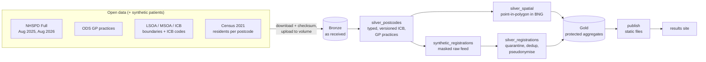

# GB Demographic & Geospatial Pipelines on Databricks

Databricks pipelines that join demographic records to GB geographic reference data (NHS and ONS
postcode products, ODS, LSOA / MSOA / ICB boundaries, Census 2021) and deliver reconciled, versioned,
pseudonymised and disclosure-controlled datasets for population analysis and service planning.

All patient-level records are **synthetic** (NHS numbers from the reserved 999 test range).
Everything else is real open data.

[](https://github.com/petersolan/GB-Demographic-Geospatial-Databricks/actions/workflows/ci.yml)

**[Live results site](https://petersolan.github.io/GB-Demographic-Geospatial-Databricks/)**: the published, disclosure-controlled outputs on a map.


*The results site (`site/`): synthetic GP registrations vs Census 2021 residents per LSOA for Exeter,
East Devon, Mid Devon and Teignbridge. Every number is disclosure-controlled.*

## What it demonstrates

| Capability | How |
|---|---|
| Databricks, PySpark, SQL, Delta Lake | 7-task medallion pipeline deployed as a Databricks Asset Bundle on serverless compute; Unity Catalog schemas per layer |
| Postcode standardisation + enrichment | Deterministic cleaning, format checks, joins to the NHS Postcode Directory (incl. terminated postcodes) and ODS practices; quarantine with reason codes |
| Spatial joins, point-in-polygon, edge cases | Native Databricks spatial SQL (`GEOMETRY`, `ST_Covers`) in British National Grid; bounding-box filter then refine; on-boundary, no-match and multi-match rules |
| CRS + geometry validation | BNG (EPSG:27700) throughout, WGS84 only for the web; `ST_IsValid`, Shapely repair UDF (no `ST_MakeValid` in Databricks); WKT / WKB / GeoJSON / GeoParquet |
| Versioned lookups and boundaries | ICB code and boundary editions as SCD2 (`valid_from` / `valid_to`); each NHSPD release joined to the edition in force; Delta time travel |
| Data quality + reconciliation | Flags per row, quarantine tables, rows-in = rows-out assertions after every join, metrics table per run, results measured against a ground truth |
| Spark optimisation | Benchmark job from 10k to 2.4M points with timeouts and query-plan capture; broadcast joins for lookups; idempotent per-version writes; repair runs |
| Access, pseudonymisation, disclosure control | Column mask on raw NHS numbers; HMAC-SHA256 `patient_id` with the key in a secret scope; year of birth + age band only (data minimisation); counts 1-9 suppressed and others rounded to 5 |
| Git, CI/CD, automated tests | GitHub Actions (ruff + 69 unit tests on open-source PySpark); integration tests that run pytest inside a Databricks job; bundle `dev` / `prod` targets |

## Architecture



Bronze, silver and gold are separate Unity Catalog schemas, so access is granted per layer: gold holds
only disclosure-controlled values and is the only source of anything that leaves the platform.

## Findings

- **The spatial check found errors in NHSPD a release before ONS fixed them.** For Devon postcodes,
  point-in-polygon and NHSPD's own LSOA assignment agree for 99.99%. All 7 disagreements in the August
  2025 release were changed by ONS in August 2026 to exactly the LSOA the spatial join had found.
- **ICB codes must follow the edition in force.** NHSPD's ICB codes match the April 2023 code list for
  the 2025 release (99.95%) and the April 2026 list for the 2026 release (99.94%); pairing the wrong
  editions loses over a quarter of English postcodes. Merged ICBs got new 5-character ODS codes, and
  NHS Hampshire and Isle of Wight kept its name with a new code (join on codes, never names).
- **Rule-based validation has a blind spot.** Blank, malformed and bad-check-digit records were all
  caught (100% against the injected defects), but 1,173 of 1,291 postcode typos produced real postcodes
  elsewhere and cannot be detected by format or NHSPD-membership checks. Plausibility rules flag 145 of
  them (12%) for review, with 4 false alarms in 507,877 correct records (see below). The real fix is
  address-level (UPRN) matching.
- **Points in water.** 23 Devon postcodes fall in no LSOA: estimated positions of terminated postcodes in
  the Exe and Taw estuaries, Plymouth Sound and the Tamar. The coast-clipped (BFC) boundaries exclude
  tidal water; these rows are kept, counted and fall back to NHSPD's assignment.
- **Real data is messier than rules.** NHSPD contains the historic Newport `NPT` postcode area and
  Girobank's `GIR 0AA`, both outside the usual postcode pattern, and 850 non-geographic postcodes with
  no location.

## Performance

Point-in-polygon of located postcodes against all 35,672 LSOAs in England and Wales, on Databricks Free
Edition serverless (`resources/benchmark_job.yml`). Two query forms: `ST_Covers` alone, and a manual
bounding-box pre-filter followed by `ST_Covers`.

| Points | `ST_Covers` only | bbox + `ST_Covers` | Join operator in the physical plan |
|---|---|---|---|
| 10,000 (South West sample) | 5.2 s | 5.7 s | `PhotonShuffledSpatialJoin` |
| 254,416 (South West region) | 6.0 s | 5.8 s | `PhotonShuffledSpatialJoin` |
| 2,413,799 (England and Wales) | 8.4 s | 8.1 s | `PhotonShuffledSpatialJoin` |

240 times more points cost about 1.6 times the time, and the manual pre-filter changes nothing: the
plan shows Databricks' native spatial join (Photon) partitions space and filters internally for both
forms. The hand-written optimisation was measured, found redundant on this engine, and would only
pay off on an engine without a spatial join operator.

## Plausibility checks

Typos that land on other real postcodes pass every format and lookup check. Candidate rules were
measured against the synthetic ground truth (1,173 such typos, 507,877 correct records):

| Rule | Typos flagged | Correct records flagged | Kept? |
|---|---|---|---|
| Postcode where Census 2021 found no residents (and it existed before Census day) | 143 | 0 * | yes |
| Home more than 15 km from the practice | 2 | 4 | yes |
| "Large user" (business) postcode | 79 | 2,548 | **removed** |

The large-user rule mostly flagged real residents of care homes, hospitals and student halls: imprecise
and biased against a vulnerable group, so it was removed (its figures are from the last run that
included it). \* The Census rule's zero false alarms is
partly an artefact of the generator (synthetic people only live where the Census found residents);
real data would produce some (conversions since 2021, Census non-response).

## Privacy and disclosure control

| Layer | What it holds | Controls |
|---|---|---|
| Bronze `gp_registrations` | Raw synthetic records incl. NHS number and date of birth | Column mask: NHS number shown only to the pipeline identity or `gbdemo_pii_readers` |
| Silver `registrations` | `patient_id` (HMAC-SHA256, key in a secret scope), year of birth, age band | No NHS number, no date of birth (data minimisation) |
| Gold | Aggregates only | Counts 1-9 suppressed, others rounded to 5; ratios from exact counts, suppressed with them |
| `site/` | Gold exports | Nothing record-level ever leaves the platform |

Not handled: secondary suppression (hiding extra cells so a suppressed value cannot be derived from
totals). It needs a cell-pattern algorithm and is out of scope.

## Limitations

- Synthetic list inflation is a uniform 5%, so area-to-area differences in the ratio are mostly noise.
- The synthetic population covers four districts: the 999 test range holds about 909,000 valid NHS numbers.
- The spatial join runs on one ICB area by default (bundle variable `spatial_scope`) to stay within the
  Databricks Free Edition compute quota.

## Repository layout

```
src/gbdemo/        pipeline logic as plain, unit-testable functions
  bronze.py          as-received loads, lineage, idempotent per-version writes
  silver.py          ANSI-safe typing, flags, versioned ICB enrichment, practice matching
  spatial.py         Databricks ST_* layer: boundaries, point-in-polygon, repair / simplify UDFs
  registrations.py   validation, quarantine, dedup, pseudonymisation, minimisation
  synthetic.py       reproducible synthetic registrations + ground truth
  gold.py, disclosure.py, reconcile.py, versioning.py, postcodes.py, nhs_number.py
pipelines/         thin job entry points (one per task)
resources/         bundle resources: schemas, volumes, pipeline job, integration-test job
databricks.yml     bundle definition: wheel build, variables, dev / prod targets
scripts/           download, prepare, upload, secret setup, fetch site data, run tests
tests/unit/        69 unit tests (Docker locally, GitHub Actions in CI)
tests/integration/ spatial tests that run pytest inside a Databricks job
site/              static results page (MapLibre) + protected data files, deployed to GitHub Pages
```

## Running it

Requires Python 3.12, Docker (for local Spark tests on Windows), the Databricks CLI and a workspace
(developed on Databricks Free Edition: serverless, Python 3.12, Spark 4.2).

```bash
# 1. data: download with checksums, convert boundaries to GeoParquet, upload to the landing volume
python scripts/download_reference_data.py
python scripts/prepare_boundaries.py
python scripts/upload_to_volume.py --volume /Volumes/workspace/dev_<user>_gbdemo_bronze/landing

# 2. pseudonymisation key (created once, never overwritten)
python scripts/create_pseudonym_key.py

# 3. deploy and run
databricks bundle deploy
databricks bundle run gbdemo_pipeline              # ~17 min on Free Edition
databricks bundle run gbdemo_integration_tests     # spatial edge cases on Databricks

# 4. results site
python scripts/fetch_site_data.py --volume /Volumes/workspace/dev_<user>_gbdemo_gold/exports
python -m http.server --directory site 8000        # http://localhost:8000
```

Unit tests: `.\scripts\run_tests.ps1 -Build` (first time) then `.\scripts\run_tests.ps1`.
In Git Bash, prefix commands that take `/Volumes/...` paths with `MSYS_NO_PATHCONV=1`.

## Data and licences

- **ONS:** NHS Postcode Directory (UK Full, Aug 2025 and Aug 2026), LSOA / MSOA 2021 and ICB
  boundaries, ICB names and codes. Open Government Licence v3.0.
- **NHS England ODS:** GP practices (`epraccur`). Open Government Licence v3.0.
- **Census 2021** residents per postcode, England and Wales, produced by the companion project
  [GB-Census-Population-Map](https://github.com/petersolan/GB-Census-Population-Map). Open Government Licence v3.0.
- Contains public sector information licensed under the Open Government Licence v3.0.
- Basemap on the results site: © OpenFreeMap, © OpenMapTiles, © OpenStreetMap contributors.
- All patient-level records are synthetic. Code: MIT (see `LICENSE`).
