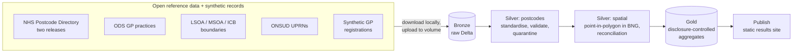

# GB Demographic & Geospatial Pipelines on Databricks

Databricks pipelines that join demographic records to GB geographic reference data
(NHS and ONS postcode products, ODS, LSOA / MSOA / ICB boundaries, UPRNs) and deliver
reconciled, versioned, disclosure-controlled datasets for population analysis and
service planning.

> **Status: work in progress.** The skeleton runs end to end on Databricks (bundle deploy →
> five-task serverless job → success); the pipeline logic is being built step by step.
> All patient-level records are **synthetic**.

[](https://github.com/petersolan/GB-Demographic-Geospatial-Databricks/actions/workflows/ci.yml)

## What it demonstrates

| Capability | How |
|---|---|
| Databricks, PySpark, SQL, Delta Lake | Medallion pipeline (bronze → silver → gold) as a Databricks Asset Bundle on serverless compute |
| Postcode standardisation + enrichment | Clean free-text postcodes, join to the NHS Postcode Directory (incl. terminated postcodes) and ODS; quarantine with reason codes |
| Spatial joins, point-in-polygon, edge cases | Native Databricks spatial SQL (`GEOMETRY`, `ST_Covers`) in British National Grid; points on boundaries, outside all polygons, or in several |
| CRS + geometry validation | BNG (EPSG:27700) / WGS84, `ST_IsValid`, repair with Shapely (Databricks has no `ST_MakeValid`); WKT / WKB / GeoJSON / GeoParquet |
| Versioned lookups and boundaries | SCD2 tables with release and validity dates; Delta time travel to reproduce past outputs |
| Data quality + reconciliation | Automated checks; counts and population reconciled before and after every join |
| Spark optimisation | Benchmark of a 41M-UPRN point-in-polygon join: naive vs H3 pre-filtering, broadcast joins, clustering |
| Access, pseudonymisation, disclosure control | Unity Catalog row filters and column masks, HMAC pseudonyms with a key in a secret scope, small-number suppression and rounding to 5 |
| Git, CI/CD, automated tests | GitHub Actions (lint + unit tests), bundle `dev` / `prod` targets, unit tests in a Linux container |

## Architecture



One schema per layer (`gbdemo_bronze`, `gbdemo_silver`, `gbdemo_gold`) so access can be
granted per layer: analysts read gold, only the pipeline touches bronze.

## Repository layout

```
src/gbdemo/        pipeline logic as plain, unit-testable functions
pipelines/         thin job entry points (one per task)
resources/         bundle resources: schemas, volume, the pipeline job
databricks.yml     bundle definition (dev / prod targets, wheel build)
tests/unit/        unit tests: run locally (Docker) and in CI
tests/integration/ spatial tests that need Databricks
scripts/           helper scripts
```

Only `src/gbdemo/spatial.py` needs Databricks (native `ST_*` functions); everything else
runs on open-source PySpark, so most of the logic is tested without a workspace.

## Running it

**Unit tests** (Linux container; Spark on Windows would need Hadoop `winutils`):

```powershell
.\scripts\run_tests.ps1 -Build      # first time builds the image
.\scripts\run_tests.ps1
```

**Deploy and run on Databricks** (Databricks CLI configured, Python with `build` installed):

```bash
databricks bundle validate
databricks bundle deploy            # dev target: names prefixed dev_<user>
databricks bundle run gbdemo_pipeline
```

Developed on Databricks Free Edition (serverless only): Python 3.12, Spark 4.2.

## Data and licences

- All patient-level records are synthetic, generated for this project.
- ONS, NHS and ODS reference products are used under the Open Government Licence v3.0.
- Code: MIT (see `LICENSE`).
